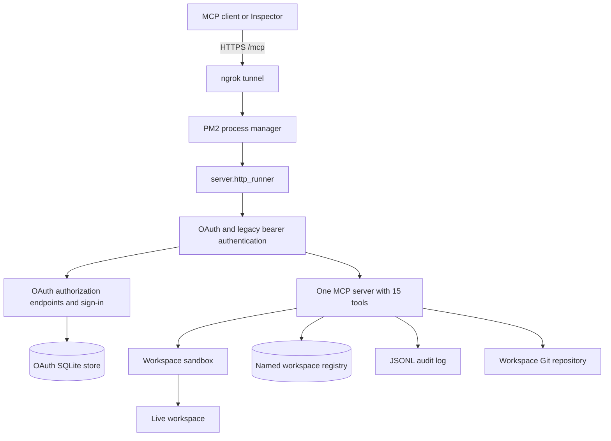

# Architecture

## Runtime flow

`server.http_runner` loads settings, builds one MCP server, and serves it under
`/mcp`. The HTTP app publishes OAuth protected-resource and authorization
metadata, supports dynamic client registration and authorization-code PKCE,
and serves a sign-in form. The owner enters `MCP_TOKEN` there; the provider
issues the registered MCP client a separate one-hour access token and a
rotating refresh token.
The OAuth SQLite database stores client registrations and token digests across
restarts. Owner sign-in authenticates one profile, and the HTTP middleware
accepts either its OAuth access tokens or the existing `MCP_TOKEN` for legacy
clients. The MCP SDK handles Streamable HTTP sessions; the application owns
path safety, tool registration, and audit records.

## Tool surface

| Authenticated MCP client | Access |
| ------------------------ | ------ |
| OAuth token              | All 15 workspace tools |
| `MCP_TOKEN` (legacy)     | All 15 workspace tools |

File deletion is reversible: `delete_file` moves a file to a unique private
`.trash` entry with metadata, and `restore_file` restores it only when the
original path is free. `remove_directory` only removes empty directories.
Permanent deletion is not exposed until a trusted approval path exists.

The live workspace is external to the server repository. This keeps application
code, credentials, logs, and workspace content separate while allowing the
workspace itself to have its own Git history.

`read_file` returns bounded chunks and continuation metadata. The AI decides
whether a chunk is sufficient for its task; when more context is needed it can
continue from `next_start_line` or batch up to five known-needed ranges. For a
complete-file request it should continue until `has_more` is false. The server
stops after the requested range and one-line lookahead by default, so
`total_lines` may be `null`. Set `count_total_lines=true` when an exact total
is needed; that scans through EOF. The 64 KiB response limit measures bytes,
not model tokens. See [Known limitations](SECURITY.md#known-limitations).

The management tools persist named absolute directory paths in
`WORKSPACE_REGISTRY_PATH` (default `logs/workspaces.json`). The configured
`WORKSPACE_ROOT` is seeded as `default` the first time. `switch_workspace`
changes the shared sandbox root for all connected clients until the process
restarts; startup returns to `WORKSPACE_ROOT`.
